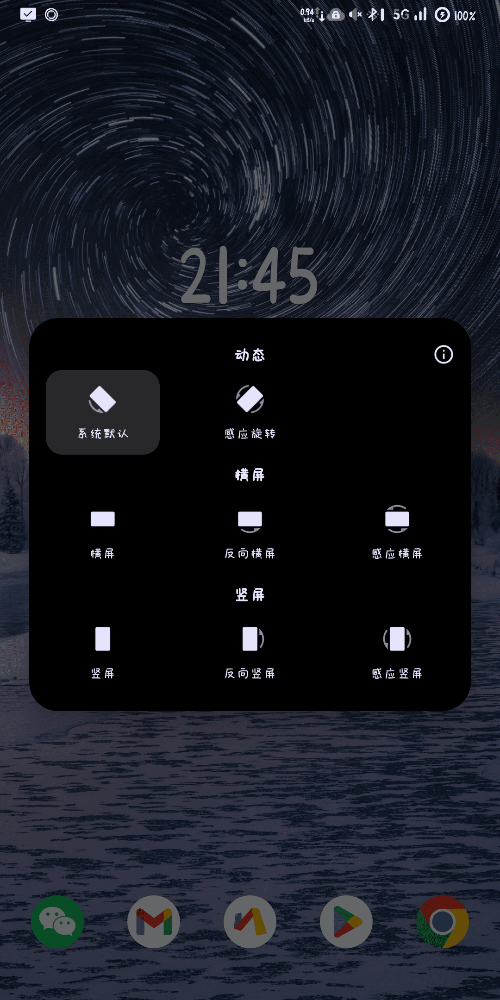

# YiTate ✨ [yitate.92li.uk](https://yitate.92li.uk)

### Made with love ❤️

YiTate 是一个开源 App，帮助你轻松锁定屏幕方向，适用于 Android 5+。

## 截图

## 特性 🌟

- **极简轻量**：体积只有不到 100k，真正的小而美哦！
- **设计简洁**：易于使用且直观的界面，轻松上手～
- **开源**：无依赖，无广告，无追踪器，纯净体验！

## 为什么开发 YiTate？ 

当你躺在被窝里耍手机，或使用一个 Android 系统的平板时，你一定会发现有些应用不支持横屏或特定方向。有时候，这真是一件让人郁闷的事儿。我尝试过市面上的一些锁定屏幕方向的应用，但它们功能太复杂，而我只想要一个简单的工具来锁定屏幕方向。于是，我就决定自己动手写一个啦！

YiTate 通过一个透明悬浮窗向系统请求所选方向，而不是修改系统的全局自动旋转设置。应用仅使用 Android 原生 API，不依赖第三方运行时库。

方向控制最终由系统执行。因 Android 版本、厂商实现或前台应用对悬浮窗的限制，某些设备或应用可能不会按所选方向旋转。通知权限可选；非默认方向需要悬浮窗权限。

## 获取

可在 [最新正式版](https://github.com/lingyicute/YiTate/releases/latest) 页面下载 APK，[Releases](https://github.com/lingyicute/YiTate/releases) 也列出历史版本和 Nightly 构建。

> [!IMPORTANT]
> Nightly 的 APK 未签名，请自行签名后安装。文件名随构建变化，请使用 [Nightly 发布说明](https://github.com/lingyicute/YiTate/releases/tag/nightly)中的 APK 链接。

## 网站字体

网页嵌入了 lingyicute 的 [Nebulove](https://github.com/lingyicute/Nebulove) 字体子集。字体是单独授权的素材，不属于下文的 GPL 代码许可；字体使用和再分发受 [Nebulove 项目嵌入许可 1.0（限非商业使用）](https://github.com/lingyicute/Nebulove/blob/df0d98ed69435d0ff1f3705c084aca057f4ca9a5/LICENSE)约束。

修改网页文案后，可用 Python 3.11 安装 `scripts/requirements.txt` 中的依赖，再运行 `python scripts/subset_font.py` 更新随仓库保存的子集。Pages 会为部署的提交生成子集，不回写 `main`。

## LICENSE 📜

Copyright (C) 2024 lingyicute.

This program is free software: you can redistribute it and/or modify
it under the terms of the GNU General Public License as published by
the Free Software Foundation, either version 3 of the License, or
(at your option) any later version.

This program is distributed in the hope that it will be useful,
but WITHOUT ANY WARRANTY; without even the implied warranty of
MERCHANTABILITY or FITNESS FOR A PARTICULAR PURPOSE.  See the
GNU General Public License for more details.

You should have received a copy of the GNU General Public License
along with this program.  If not, see https://www.gnu.org/licenses.
